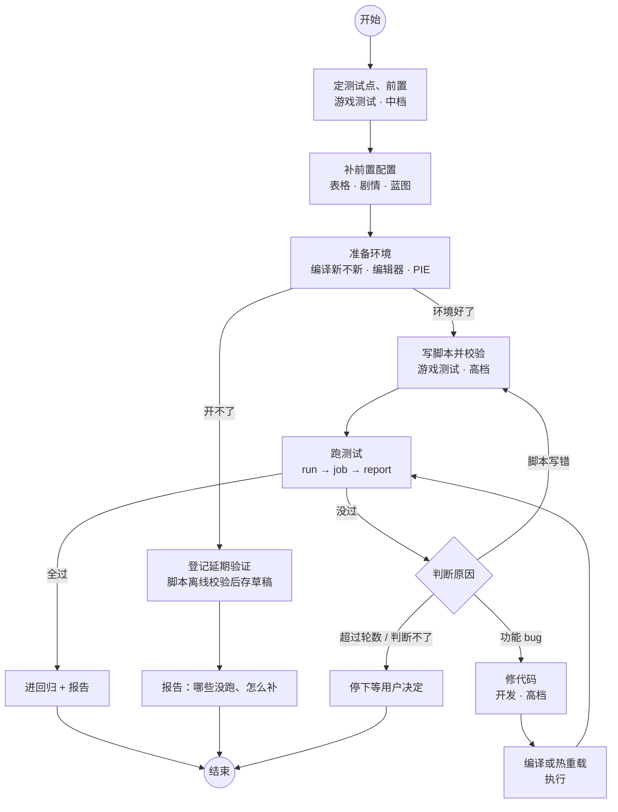
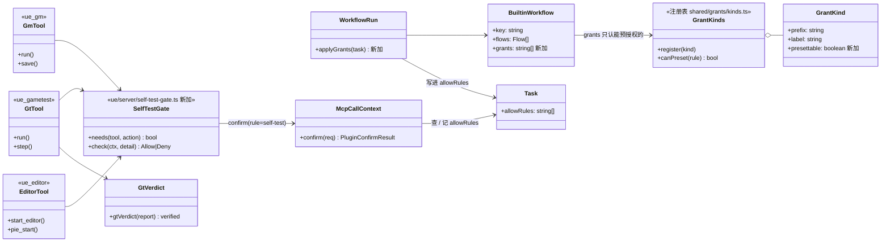
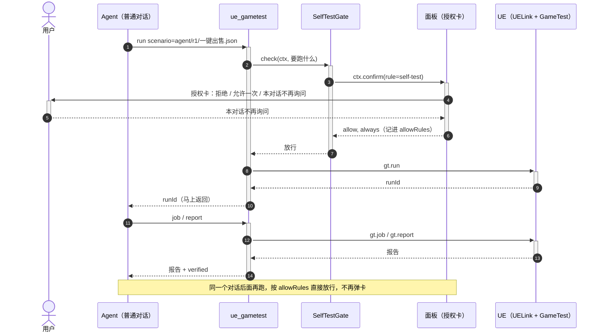
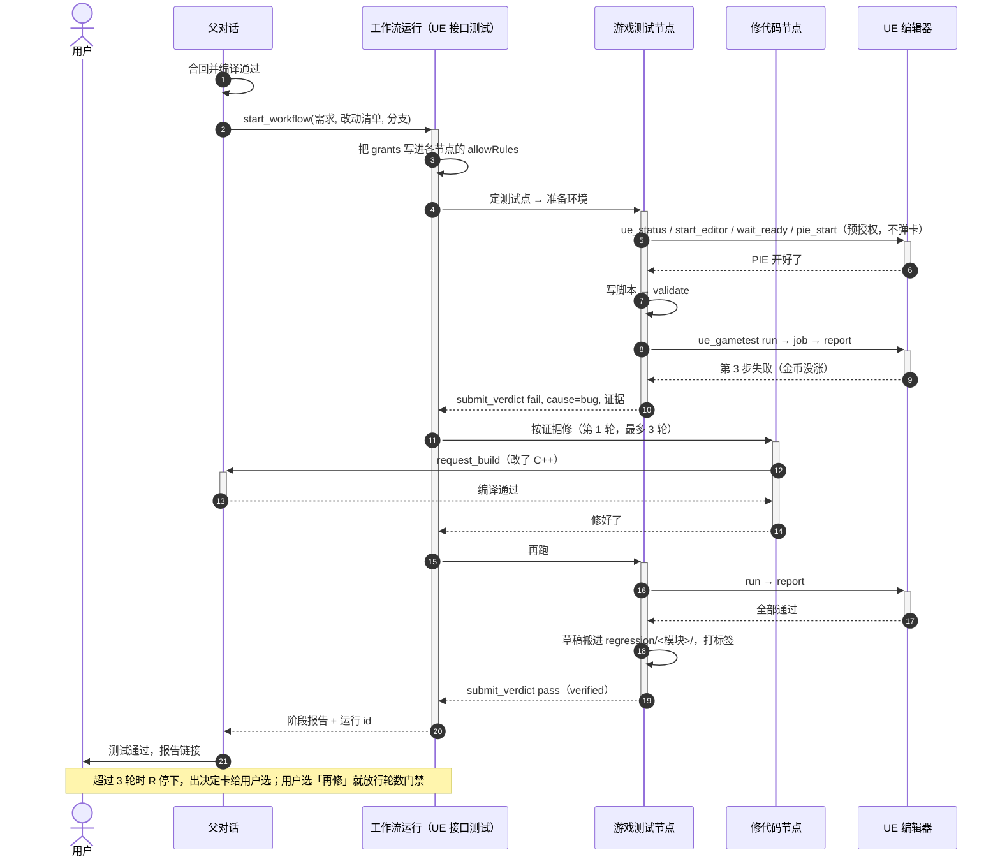

# UE 项目：Agent 写完代码自己写测试、跑测试 · 设计稿

> 状态：已实现（2026-11-25，UE 插件 0.61.0 + 面板插件接口 20）。和下文设计稿的差别见「实现说明」，其余照设计稿。

## 实现说明（和设计稿不同的地方）

- **名字**：工作流叫「UE 游戏内测试」（key `ue-ingame-test`），不叫「UE 接口测试」。
- **选地图**：第一个节点「定测试点和地图」带确认，用节点阶段报告弹一张选择卡问地图，默认第一项是编辑器当前打开的地图，用户确认后才往下走。
- **不用 `fail:<原因>` 连线**：面板的工作流是无环图，连线只认 `''` / `pass` / `fail`。「写脚本 → 跑 → 修」的循环做在「写脚本并跑」节点的验收子流程「核对结果」里，最多 3 轮；超过轮数节点失败，由父对话决定再修还是登记延期验证。改脚本的 5 次尝试写在节点说明里，由 Agent 在节点内自己计数。
- **原地运行**：工作流定义加 `inPlace`（「直接在父对话的目录里改」）。UE 编辑器读的是项目目录，独立分支里的改动编辑器看不到，所以这个工作流不开独立分支。
- **自带授权**：工作流定义加 `grants`（规则键 + 说法），运行时按工作流快照放行，不写进对话的放行规则；工作流详情「团队与说明」→「运行方式」里能看到，也能去掉某条授权。只有注册表标了 `presettable` 的授权类型（目前只有插件授权 `plugin:`）能预授权，插件只能给自己的规则（`plugin:<自己的 id>:`）。
- 不拦 `ue_call` / `ue_set`；授权卡每个普通对话都弹，不按「用户说过写测试」直接放行。
- **先补前置、按正常流程测**（0.68.0，用户 2026-11-27 看了碰杯玩法的测试对话后定）：以前 Agent 碰到缺配置（剧情实例不存在）就在运行时把配置指向别的行、写项目接口直接调 `StartGameplay`、在事件回调里替玩家出招，入口那段（走近 NPC、按交互键、E 类对话、点选项）一步没走；三轮修的全是脚本自己。现在第一个节点改叫「定测试点、前置和地图」，按正常游戏流程排步骤和前置清单（NPC 配置、状态蓝图、对话 / 剧情和选项按钮、引导、表格行），新加节点「补前置配置」（`prep`，pass 接准备环境、fail 接登记延期）用 `table.*` / `ue_asset` / `ue_blueprint` 补齐并导表；「写脚本并跑」要求链路上每一步走输入和界面、项目接口只准备状态和只读查询，跑之前打 `ue_lua snap` 快照点、跑完对照日志写代码分析；「核对结果」查有没有绕过正常流程。`ue_gametest action=job` 在工具里等到跑完、有步骤失败或批量里又完成一个（最多 45 秒，`gt-job-wait.ts`），那次对话里它被轮询了 333 次。
  > 涉及：面板 `fixcode-h/agent-panel`（工作流预授权），UE 插件 `fixcode-h/agent-plugins` 的 `ue/`（授权卡、工作流、技能），UEKit 的 GameTest 不用改 C++。

## 0. 结论

1. **推荐新增一个独立工作流「UE 接口测试」**，放在 UE 插件的清单里（`plugin.json` 的 `workflows`），插件打开时装上、关掉时清掉，走面板现成的插件内容机制（`shared/builtin/plugin-content.ts`，和「UE 性能分析」同一套）。
2. **已有的开发工作流不塞测试节点**，只在「编译通过之后」接上这个工作流：「UE 项目」工作流合回并编译通过后，父对话起一次「UE 接口测试」运行；「功能开发（OpenSpec）」的「延期验证项」里列出「游戏内验证」，用户选「立即验证」时也起它。测试的写法和跑法只有一份。
3. **权限按你说的分两种**：
   - 普通 Agent 对话里，Agent 第一次要自己用 GameTest 或 GM 来测试时，弹一张授权卡（拒绝 / 允许一次 / 本对话不再询问），点了才继续。这张卡和「提问」开关无关，开关关着也弹。
   - 「UE 接口测试」工作流在定义里声明预授权，运行时不弹这张卡。
4. 编辑器或 PIE 没开时，工作流先自己准备环境：编译过期就申请编译，然后启动编辑器、开 PIE。实在开不了就登记成「延期验证」，脚本先离线校验好存着，不算失败。
5. 测试失败先分清是功能 bug 还是脚本写错。功能 bug 回到修代码节点，修完重新编译或热重载再测，默认最多 3 轮；脚本问题单独算，最多 5 次。超过轮数就停下，出一张决定卡让你选，你选了什么就照着执行，门禁不拦。

## 1. 现在已经有什么

| 能力                                                                                                                                                   | 在哪                                                                                                   | 这次怎么用                                                                                          |
| ------------------------------------------------------------------------------------------------------------------------------------------------------ | ------------------------------------------------------------------------------------------------------ | --------------------------------------------------------------------------------------------------- |
| `ue_gametest`：look（status / props / widgets / vars / api / scenarios / gmRecent）、validate、run、step、resolve、inspect、job、report、history、stop | `ue/server/uekit/gt-tool.ts`                                                                           | 写脚本、校验、跑、取报告，不加 action                                                               |
| 跑通过的场景算完成依据（`verified`）                                                                                                                   | `ue/server/uekit/gt-verdict.ts`                                                                        | 测试节点交结论时直接用，不读模型的回复文字                                                          |
| `ue_gm`（执行和保存自定义 GM）、`ue_call` / `ue_set` / `ue_find`                                                                                       | `ue/server/tools.ts`                                                                                   | 准备测试状态；脚本里用 `gm.run`、`obj.call`                                                         |
| `ue_editor`：start_editor、wait_ready、pie_start / pie_stop / pie_status、livecoding                                                                   | `ue/server/tools.ts`                                                                                   | 准备环境                                                                                            |
| 「游戏测试」角色 + 技能 `ue-gametest-authoring`                                                                                                        | `ue/plugin.json` agents、`ue/skills/engineering/`                                                      | 工作流里写脚本和判断失败原因都用它                                                                  |
| 钩子 `gt-offer`：编译过、没问过时，在收尾前拦一次，让 Agent 问「要不要写 GameTest」                                                                    | `ue/server/gt-offer.ts`                                                                                | **换成第 4 节的授权卡**（现在的做法要靠模型自己去问，而且「提问」开关关着时问题根本到不了用户那里） |
| `UE_VERIFY_RULE`：验证到编译为止，不跑 Automation RunTests                                                                                             | 面板 `shared/test-steps.ts`                                                                            | 保留。文字改成「要在游戏里验证，用 GameTest / GM，第一次会弹授权卡」                                |
| 授权卡统一用「本对话不再询问」，授权类型有注册表                                                                                                       | 面板 `shared/grants/kinds.ts`、`web/src/components/tasks/GrantActions.tsx`、插件 `ctx.confirm({rule})` | 新加一类授权 `plugin:ue:self-test`                                                                  |
| 插件工作流随插件装上、卸载                                                                                                                             | 面板 `addPluginContent` / `planPluginRemoval`                                                          | 「UE 接口测试」直接用                                                                               |
| 节点验收子流程、`maxRounds`、按 pass / fail 分支、节点完成后等用户确认                                                                                 | 面板 `shared/schema.ts` 的 NodeHooks / NodeStep / Edge.when                                            | 失败后回到修代码的循环                                                                              |
| 阶段报告常驻入口（ADR 0069）、工作报告                                                                                                                 | 面板 `shared/flow/stage-report.ts`                                                                     | 展示测试结论                                                                                        |
| GameTest 页的报告、证据、批量结果组件                                                                                                                  | `ue/web/sections/uekit/GtEvidence.tsx`、`GtBatch.tsx`、`GtStepHistory.tsx`                             | 报告展示直接复用，不另写                                                                            |

结论：写脚本、跑脚本、读报告的能力都已经齐了。缺的是三样：**什么时候测**（接进流程）、**谁同意测**（授权）、**没通过怎么办**（循环和轮数）。

## 2. 目标和非目标

**目标**

- UE 项目里改完能在游戏里用到的功能（玩法、界面、Lua 逻辑、游戏数据）后，Agent 能自己定要测哪些点，写 GameTest v5 脚本（可以带 GM、对象引用、项目接口），校验、跑、看报告，没通过就修，通过的脚本进回归集。
- 普通对话先问你，工作流不问。
- 编辑器没开、PIE 没开、正在编译这些情况都有明确的处理，不会卡住，也不会悄悄跳过。

**非目标**

- 不跑引擎的 Automation RunTests / Gauntlet。规则不变，面板守卫照样拦。
- 不改 UEKit 的 C++，GameTest 现有的动作已经够用。
- 不新加 MCP 工具（ADR 0067 准入四问：现有的 `ue_gametest` / `ue_gm` / `ue_editor` 都能做到）。
- 不做性能测试，那是「UE 性能分析」的事。

## 3. 两种接入方式

### 3.1 方式一：嵌进现有的开发工作流

做法是在「UE 项目」和「OpenSpec」工作流的实现节点后面，或者在收尾验收（评审 → 测试）里，加一个「游戏内测试」节点。

| 好处                             | 问题                                                                                                                                                                                                        |
| -------------------------------- | ----------------------------------------------------------------------------------------------------------------------------------------------------------------------------------------------------------- |
| 一条流程跑到底，用户不用再起一次 | **时机不对**：「UE 项目」规定编译归父对话，评审之后才申请编译。实现节点和收尾验收跑的时候代码还没编译，GameTest 跑的还是旧代码                                                                              |
|                                  | OpenSpec、通用项目都是面板内置、不分项目类型的工作流，要加只对 UE 生效的条件节点。面板内置模板会反过来依赖插件的角色（「UE 项目」现在的实现节点已经写了「可用角色里有游戏测试时」，靠的是提示词判断，不稳） |
|                                  | 插件关掉以后，内置工作流里留着一个找不到角色的节点                                                                                                                                                          |
|                                  | 每个开发工作流各接一份，写法很容易走样                                                                                                                                                                      |

### 3.2 方式二：独立的「UE 接口测试」工作流，跟着 UE 插件装卸

| 好处                                                                             | 问题                                                      |
| -------------------------------------------------------------------------------- | --------------------------------------------------------- |
| 跟着插件装上、卸载，面板已经有这套机制，不用新做                                 | 需要有人来起它：父对话、OpenSpec 的延期验证，或者用户手动 |
| 测试的写法、环境准备、失败循环、轮数只维护一份                                   | 多了一次工作流运行（多一份运行记录）                      |
| 可以排在编译之后，跑到的是新代码                                                 |                                                           |
| 单独也能用：「给这个功能补回归」「这次改动在游戏里测一下」，不一定要接在开发后面 |                                                           |
| 预授权只给这一个工作流，别的工作流（比如性能分析）不会顺带拿到                   |                                                           |

### 3.3 推荐：方式二做引擎，方式一只留一个接口

- 「UE 接口测试」是唯一的测试流程。
- 「UE 项目」工作流不加节点，只改约定和提示词：合回并编译通过后，父对话用 `start_workflow` 起「UE 接口测试」，输入是这次的需求、改动清单和分支。实现节点里「先问用户要不要写 GameTest」那一段删掉：工作流本来就是你主动起的，你说过这种情况不用再问。
- 「OpenSpec」的「延期验证项」：UE 项目里多列一项「游戏内验证（UE 接口测试）」。你选「立即验证」就起它，选「暂缓」就标成待用户完成。
- 普通对话（没走工作流）：Agent 自己想测时弹授权卡（第 4 节）。你也可以直接说「跑一下接口测试」，父对话起这个工作流。

## 4. 授权：普通对话弹卡，工作流不弹

### 4.1 拦哪些调用

只拦「真的动到游戏」的测试动作。查询类的不拦，Agent 先查一查、写个草稿不打扰你：

| 调用                                                                              | 拦不拦                                                                                                      |
| --------------------------------------------------------------------------------- | ----------------------------------------------------------------------------------------------------------- |
| `ue_gametest` run / step                                                          | 拦                                                                                                          |
| `ue_gm` 执行 GM、保存自定义 GM                                                    | 拦                                                                                                          |
| `ue_editor` pie_start（测试前开 PIE）                                             | 拦，和上面算同一类授权                                                                                      |
| `ue_gametest` look / validate / resolve / inspect / job / report / history / stop | 不拦（只读，或者是停下）                                                                                    |
| `ue_call` / `ue_set` / `ue_find` / `ue_get`                                       | 不拦。它们是调试的基本工具，「UE 调试」角色天天用，权限由「权限与设置」管（默认全放开，用户 2026-11-19 定） |
| 往场景根写脚本文件                                                                | 不拦。写文件不会动游戏，跑之前的那次 run 会弹卡                                                             |

> 待你定（问题 1）：`ue_call` / `ue_set` 要不要也算进来？算进来最严，但排查问题时也会弹卡。

### 4.2 卡片长什么样

插件在工具里调 `ctx.confirm`，带上授权类型：

```ts
ctx.confirm({
  title: '让 Agent 自己用 GameTest / GM 测试',
  detail:
    '要跑：regression/Bag/一键出售.json（6 步：发道具 → 打开背包 → 一键出售 → 查金币和格子数）\n会在 PIE 里操作界面、执行 GM「发道具」',
  rule: 'self-test',
  ruleLabel: '自己写和跑游戏内测试（GameTest / GM）',
})
```

- 按钮用共用的 `GrantActions`：拒绝 / 允许一次 / **本对话不再询问**（主按钮）。规则记成 `plugin:ue:self-test`，存在 `task.allowRules` 里，设置 →「授权卡」里也能看到这一类。
- **和「提问」开关无关**：这是授权卡，不是提问。`gt-offer` 现在的做法（拦一次、让 Agent 自己去问）删掉。
- 不同意：工具返回「用户没同意在游戏里测试，验证到编译为止；要测的话回我『写 GameTest』」，Agent 不许绕路（比如改用 `ue_lua` 去跑同样的东西）。
- 用户自己在这个对话里说过要测（「写个测试」「跑一下 GameTest」）：**照样弹一次**，但默认按钮已经选在「本对话不再询问」上，点一下就行。不按用户原话自动放行，原因是要从文字里猜意图，容易判错。

> 待你定（问题 2）：用户亲口说过「写测试」时，要不要直接放行、不弹卡？可以靠 `ctx.userWords()` 认几个关键词，但会有误判。

- 用户在 UE 页「游戏测试」里自己点运行，不经过 Agent，不弹卡。

### 4.3 工作流怎么做到不弹：在工作流定义里声明预授权

面板加一个通用字段（插件和面板内置的工作流都能用）：

```jsonc
// plugin.json → workflows[]
{
  "key": "ue-selftest",
  "name": "UE 接口测试",
  "grants": ["plugin:ue:self-test", "plugin:ue:start-editor"],
  ...
}
```

- 工作流运行开始时，面板把 `grants` 写进这次运行里每个节点对话（包括它派出的子任务）的 `allowRules`。插件的 `ctx.confirm` 碰到已经放行的规则，直接按允许返回，对话里留一行「工作流预授权：自己写和跑游戏内测试」，可以追查。
- 不用「对话类型是工作流就放行」（`run.kind === 'workflow'`）这种写法：那样「UE 性能分析」之类的工作流也会顺带拿到授权。现在是哪个工作流要，就在哪个工作流里声明。
- 只认注册表里登记过、并且允许预授权的类型（`shared/grants/kinds.ts` 加 `presettable: true`）。危险命令守卫、凭据守卫这类不能预授权。
- 工作流详情页的「约定」下面显示「这个工作流自带的授权：…」，用户复制一份改过的工作流时也能删掉。

## 5. 「UE 接口测试」工作流

### 5.1 成员

| 角色                      | 来源        | 做什么                                                         |
| ------------------------- | ----------- | -------------------------------------------------------------- |
| 游戏测试（`ue-gametest`） | UE 插件已有 | 主角色：定测试点、准备环境、写和跑脚本、判断失败原因、整理回归 |
| 开发（`developer`）       | 面板内置    | 功能 bug 时修代码                                              |
| 执行（`worker`）          | 面板内置    | 修完以后申请编译或热重载（编译归父对话，规则不变）             |

### 5.2 流程



各节点要做的事：

1. **定测试点**：读输入里的需求和改动清单（没有就按分支相对基线的 diff），每个点写成一句「做了什么之后，应该看到什么」，再给每个点挑写法（走界面 / 调接口 / GM 准备状态）。默认不停下来等确认（你说工作流不需要确认），节点参数 `confirmScope` 打开时才等。测试点写进阶段报告。
2. **准备环境**：见第 6 节。
3. **写脚本并校验**：按 `ue-gametest-authoring` 技能写 v5 脚本，先用 `look what=scenarios` 找能复用的 `common/` 子脚本；准备状态按「执行 GM → 对象调用 → Lua 代码节点 / 函数库」选，不往项目里加测试 Lua 文件、不为测试写 C++ 接口（用户 2026-11-28）；`validate` 全部通过才往下走。
4. **跑测试**：`run scenario=…`（多个时用 `scenarios` 批量）→ `job` 等结果 → `report`。节点结论看 `verified`（`gtVerdict`），不看模型的回复文字。
5. **判断原因**：按技能里「失败了怎么判断」那张表，交 `submit_verdict`，带 `cause: 'script' | 'bug' | 'env' | 'unknown'`，再加证据（步骤 id、实际值、日志行、截图路径）。走哪条分支看 `cause` 字段（第 7 节）。
6. **修代码 → 编译或热重载**：开发角色按证据修。改的只有 Lua 时，用 `ue_lua reload` 热重载，不用编译；改了 C++ 时，执行角色 `request_build`（共用目录），或者在运行自己的分支里申请编译。改了 C++ 并且 Live Coding 能用的（`ue_editor livecoding`，限函数体内的改动）可以先用 Live Coding 试，不行再完整编译。
7. **进回归 + 报告**：通过的脚本从草稿目录搬进 `regression/<模块>/`，打标签（第 8 节）；写阶段报告（第 9 节）。

### 5.3 这个工作流的「约定」（写进 `document`，给用户和 Agent 看）

- 只在编译通过后跑。代码还没编译时，先申请编译。
- 准备状态用接口或 GM，被测的操作走界面，检查时数据和界面都要看。
- 不用 `disabled`、`onFail: continue`、放宽断言、`many: "first"` 来让测试通过。
- 修代码只修和失败证据有关的地方，不顺手重构。
- 推送、合并由父对话决定。

## 6. 编辑器、PIE 没开时怎么办

「准备环境」节点按下面的顺序走，每一步都看工具返回的状态，不靠猜：

| 状态（`ue_status` / `ue_editor pie_status`）                              | 普通对话（已授权）                                            | 工作流                                                                                                                                                   |
| ------------------------------------------------------------------------- | ------------------------------------------------------------- | -------------------------------------------------------------------------------------------------------------------------------------------------------- |
| 编译过期（改了 C++、二进制比源码旧；UE 页已经有 `StaleBuildHint` 的判断） | 告诉用户要先编译，按 `UE_VERIFY_RULE` 申请编译                | 执行角色 `request_build`，等编译结果推回来                                                                                                               |
| 正在编译、编辑器被编译锁着                                                | 等（面板推送编译结束），不轮询                                | 同左                                                                                                                                                     |
| 没有编辑器进程                                                            | 弹卡「启动编辑器？」（`ue_editor start_editor` 本来就要确认） | 预授权 `plugin:ue:start-editor`：直接启动（VS 开着就经 VS 按 F5 启动），然后 `wait_ready`                                                                |
| 只有后台编辑器（不开窗口的那种）                                          | 跑不了界面测试：要换成正常的编辑器，先关掉后台编辑器再启动    | 同左，自动处理                                                                                                                                           |
| 编辑器开着、没开 PIE                                                      | 弹授权卡，然后 `pie_start`                                    | 直接 `pie_start`。脚本开头不写 `pie.start` 步骤，由节点统一开，这样回归脚本在已经开着 PIE 时也能跑                                                       |
| 用户自己正在玩 PIE                                                        | 不打断：问用户「用你现在的 PIE 跑，还是等你玩完」             | 不打断：等用户结束（面板的「等用户操作」，ADR 0055，建议等 10 分钟），超时就登记延期                                                                     |
| 启动失败、`wait_ready` 超时、项目没接入 UE                                | 原样报错（Agent 执行出的错误一律给用户看），到此为止          | 登记**延期验证**：脚本做离线 `validate`（只查结构）后存草稿；运行结果标「待用户完成」，报告里写清缺什么、怎么补（UE 页「游戏测试」→「待跑」→「跑这批」） |

- 测试结束：PIE 是这次自己开的就 `pie_stop`；编辑器是自己启动的就留着（下次还要用，关不关由用户定）。
- 已知的坑：`gt.run` 在没开 PIE 时会怎么返回，需要在真实 UE 上核实一次。如果是马上报错，就照上表处理；如果它会自己开 PIE，就去掉「节点统一开 PIE」这一步，免得开两次。

## 7. 失败以后回到修代码，轮数和用户确认

### 7.1 两种轮数分开算

| 预算                     | 默认 | 算一轮的条件                                      |
| ------------------------ | ---- | ------------------------------------------------- |
| 修功能（`fixRounds`）    | 3    | 判断为功能 bug → 修代码 → 重新编译或热重载 → 再跑 |
| 改脚本（`scriptRounds`） | 5    | 判断为脚本写错 → 改脚本 → 再跑                    |

- 两个数都是工作流节点上的参数，用户可以在工作流里改，范围 1–10，和面板 `maxRounds` 的范围一致。
- 判断看 `submit_verdict` 的 `cause` 字段，不看回复里的文字（ADR 0041 / 0049）。
- 同一个步骤连续两轮在同一个地方、用同样的证据失败，提前停下，不把剩下的轮数用完。

### 7.2 超过轮数、判断不了、环境问题反复出现

停下来出一张**决定卡**：

- 再修 N 轮（N 默认 2）
- 保留脚本、标「已知失败」，交给开发看（脚本放进 `regression/` 并带 `known-fail` 标签，回归时单独列出来，不算新的失败）
- 只保留通过的那部分，失败的脚本留在草稿里
- 停下，我自己看报告

**用户的指令优先**（用户 2026-11-19 定的长期原则）：用户选了「再修 N 轮」，或者在对话里说「一直修到过为止」，轮数门禁就放行（`request_override`，gate `selftest-rounds`），不许再拦。只有每一轮仍然要满足「不放宽断言」这些约定。

### 7.3 改代码的范围

- 修代码的节点只修和失败证据有关的文件，改动记进这次运行的改动清单，评审照常进行（运行跑完后面板接的收尾：评审 → 测试）。
- 这个工作流是接在「UE 项目」运行之后起的时候，修的代码进**同一个分支**，由父对话一起合回，不另开分支。

## 8. 测试脚本放在哪

场景根照 GameTest 现在的规则（跟着文档根走：项目外层有 `ProjectDoc/docs` 就放 `ProjectDoc/docs/GameTest`，否则放项目里的 `docs/GameTest`，以 `look what=status` 的 `scenarioRoot` 为准）：

```
<场景根>/
  regression/<模块>/<功能>.json      通过的，进回归集
  common/<名字>.json                 能复用的子脚本（登录、翻完引导、回主界面）
  agent/<运行 id>/<功能>.json        草稿：还没通过的、延期验证的
  _settings.json / _api.json         原样不动
```

- **标签**：`[<模块>, "regression", "agent"]`，再加上来源 `"run:<运行 id>"`，以后能按运行查到是哪次改动写的。已知失败的再加 `"known-fail"`。
- **先写草稿，通过了才搬进 `regression/`**：回归集里只有跑通过的，`run tag=regression` 不会被没写完的脚本污染。搬动复用场景库已有的移动脚本操作（场景库文件夹整理那一套），草稿没用了，跑完 7 天后在 UE 页提示清理（只提示，不自动删）。
- **测试用的 Lua** 只写在 Lua 代码节点或面板的 Lua 函数库（`AgentPanel/UE/gametest-lua.json`），不进游戏项目；项目接口（`GameTestApi/`）GameTest 2.9.0 起不再用（用户 2026-11-28）。
- **自定义 GM**：Agent 为测试保存的 GM 进 GM 库的「自定义」分类，模块必选（已有规则），名字前加 `[测试]`，GM 页能筛出来。
- P4 项目：脚本照 P4 规则先 `p4 add`，按 [Other] 分进 pending（「UE 项目」的分 pending 规则不变）。

## 9. 报告怎么展示：只用现成的组件

| 在哪看                                    | 用什么                                                                                                      | 新做的部分                                                                                                               |
| ----------------------------------------- | ----------------------------------------------------------------------------------------------------------- | ------------------------------------------------------------------------------------------------------------------------ |
| 工作流节点的阶段报告（ADR 0069 常驻入口） | 面板的阶段报告                                                                                              | 「跑测试」「进回归」两个节点的报告里固定几节：测试点 → 脚本 → 结果（通过 / 失败 / 延期，带运行 id）→ 失败证据 → 修了什么 |
| 点运行 id、截图路径                       | UE 页「游戏测试」的报告视图（`GtEvidence`、`GtStepHistory`、`GtBatch`）                                     | 一个深链 `#/plugin/ue/gametest/run/<runId>`，阶段报告里的运行 id 直接跳过去。不在对话里另画一套报告                      |
| 完成依据                                  | `verified`（`gtVerdict`）进对话的完成依据和工作报告（ADR 0043 / 0056）                                      | 不用新做                                                                                                                 |
| 延期验证                                  | OpenSpec 延期验证那一套「待用户完成」 + UE 页「游戏测试」左栏加一组「待跑」（就是按 `agent/` 草稿目录过滤） | 左栏的过滤项                                                                                                             |
| 普通对话                                  | 工具结果里的报告摘要（`ue_gametest report` 现在的输出）+ 运行 id 深链                                       | 不用新做                                                                                                                 |

## 10. 跟着插件装上和卸载

- `ue/plugin.json` 的 `workflows` 加 `ue-selftest`（和 `ue-perf` 并列），面板打开插件时按 `builtin:ue-selftest` 建副本，关掉时按 `planPluginRemoval` 的规则清：改过的、被项目用着的保留，并在插件页上写明原因。
- 角色复用插件已有的 `ue-gametest`，面板内置的 `developer` / `worker` 按 key 引用（面板的 `addBuiltinWorkflow` 会把缺的角色一起建出来）。
- 授权类型 `plugin:ue:self-test`、`plugin:ue:start-editor` 由插件声明（第 11.2 节），插件关掉以后，设置 →「授权卡」里不再列出。
- `gt-offer` / `gt-offer-track` 两个钩子删掉，换成工具里的授权卡。
- 面板老版本不认 `grants` 字段时，工作流照样能装，只是运行时会弹卡（往旧版本退一步还能用）。所以插件清单的 `api` 升到新的接口版本，旧面板装的时候提示升级面板。

## 11. 类图和时序图

### 11.1 类图



### 11.2 时序图一：普通对话第一次自己测



### 11.3 时序图二：「UE 项目」编译后接「UE 接口测试」，失败后回去修



## 12. 改动清单和分期

**第一期：授权卡（普通对话）**，UE 插件一个小版本：

- `ue/server/self-test-gate.ts`：一张表登记要拦的工具和 action，`ue_gametest` run / step、`ue_gm` run / save、`ue_editor` pie_start 都走它（按「接口 + 注册表」写，以后别的插件要类似的卡可以挪进面板）。
- 删掉 `gt-offer.ts` 和清单里的两个钩子。`UE_VERIFY_RULE` 改写成「要在游戏里验证就用 GameTest / GM，第一次会弹授权卡，不同意就到编译为止」（面板 `shared/test-steps.ts`）。
- 技能 `ue-gametest-authoring` 第 0 步「先问用户」改成「工具会弹授权卡，不用自己问」。

**第二期：面板的工作流预授权**，面板一个小版本：

- `shared/schema.ts`：Workflow / BuiltinWorkflow 加 `grants`；`shared/grants/kinds.ts` 加 `presettable`，插件能登记自己的授权类型。
- 工作流运行开始时，把 `grants` 写进节点对话的 `allowRules`（`server/tasks/` 起运行的地方；子任务继承）。
- 工作流详情页显示自带的授权；插件接口版本加一（SDK 同步到插件仓库的 `sdk/`）。
- 迁移：不用（新字段有默认值，是空数组）。

**第三期：「UE 接口测试」工作流**，UE 插件一个次版本：

- `plugin.json` 的 `workflows` 加 `ue-selftest`（第 5 节），`grants` 写两类。
- 「判断原因」用 `submit_verdict` 加 `cause` 字段，按它分支。面板的 Edge.when 现在只有 pass / fail，要加按字段分支（`when: 'fail:bug'` 这种写法），或者把判断节点拆成两个出口。这一点要在面板里定，见问题 4。
- 轮数门禁 `selftest-rounds` 接 `request_override`。
- GameTest 页：深链 `#/plugin/ue/gametest/run/<runId>`、左栏「待跑」过滤。

**第四期：接进开发工作流**，面板：

- 「UE 项目」的约定和实现节点提示词：删掉「先问要不要写 GameTest」，加上「合回并编译后，父对话起 UE 接口测试（装了 UE 插件、并且有能在游戏里用到的改动时）」。
- 协调器 / 父对话的提示词：编译通过后可以起这个工作流，按装了哪些插件判断，不按插件名字写死。
- OpenSpec 的延期验证节点：UE 项目里列出「游戏内验证」。

每一期上线前，都要在云端演示版（面板 + UE 插件 + 假 UE 连接）里真的点一遍：授权卡的三个按钮、「本对话不再询问」以后不再弹、工作流运行不弹卡、编辑器没开时登记延期、超过轮数出决定卡（用户 2026-11-23 定的测试要求）。

## 13. 待你定

1. **`ue_call` / `ue_set` 要不要也弹授权卡？** 推荐不弹：它们是调试的基本工具，已经有「权限与设置」管着。
2. **你亲口说过「写测试」时，要不要直接放行？** 推荐照样弹一次（默认按钮选「本对话不再询问」，点一下就行），不按文字猜意图。
3. **工作流的名字**：「UE 接口测试」（照你的说法），还是「UE 游戏内测试」？它测的不只是接口，界面和玩法也测。推荐「UE 游戏内测试」。
4. **失败原因的分支怎么做**：面板的连线条件加 `fail:<原因>`（通用，别的工作流以后也能按原因分支），还是这个工作流里拆成两个判断节点（只改插件）？推荐前者，在面板里做成通用能力。
5. **「UE 项目」工作流跑完以后，是自动起接口测试，还是父对话问一句再起？** 推荐自动起（你说工作流不需要确认），父对话在回复里说一句「正在跑游戏内测试」。
6. **默认轮数**：修功能 3 轮、改脚本 5 轮，可以吗？
