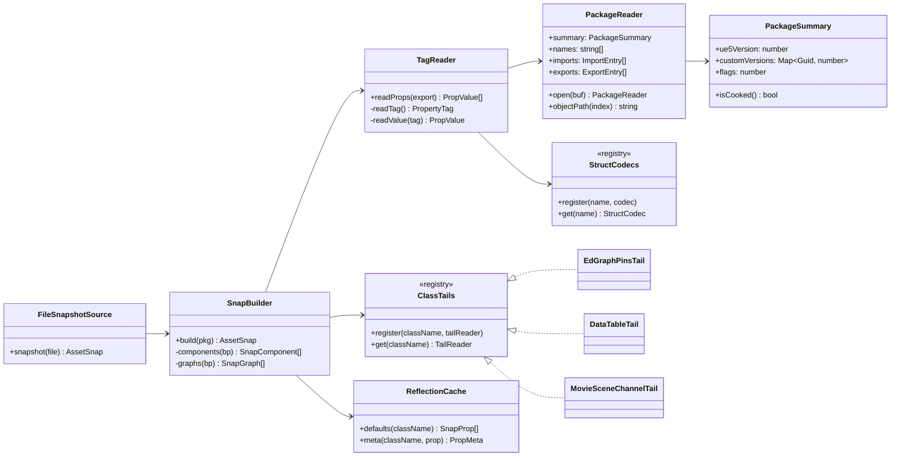
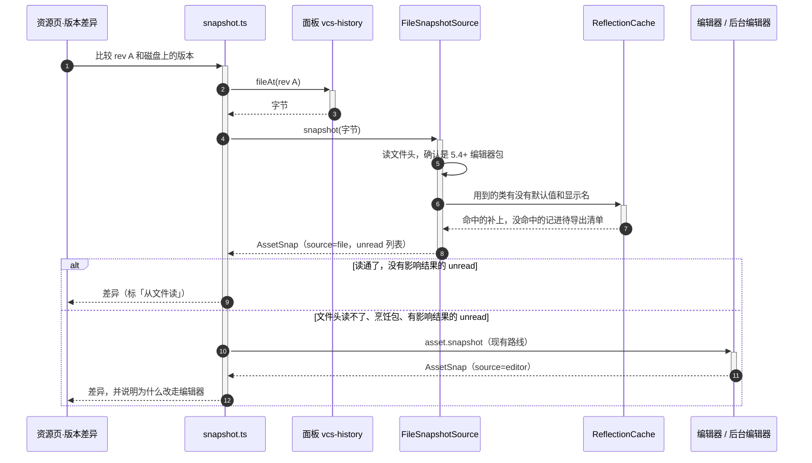

# 不开 UE 编辑器读 .uasset：照引擎源码自写解析 · 评估

2026-11-25 · 评估和设计。同日用户定方向：自写 TS，编辑器没开时不再起后台编辑器读结构，统一用它；**只读，修改资源必须开编辑器**（用户 2026-11-25：避免 TS 写坏资源导致打不开）。已实现的部分见文末「实现状态」。
接着 2026-11-20 那次评估（项目文件 `designs/UE不启动编辑器读uasset-评估.md`，当时推荐 CUE4Parse）往下深入，回答用户这次的问题：**手里有 UE 源码，自己照着写一套读取代码，能不能直接解析 .uasset（蓝图组件、属性等）**。

## 1. 结论

1. **能，而且这次实测过了。** 用 64 行 Node 脚本、不依赖任何库，从零读 UE 5.7 编辑器保存的 5 个蓝图（文件格式版本号和 5.8 相同，都是 1018），**133 个导出对象的属性区全部读通**，结尾位置和文件里记的完全对齐。最大的 138KB 蓝图读完只要 2 毫秒（见第 3 节）。
2. **「照源码写同样的代码」这句话要拆开看。** UE 读包的代码分三层，难度差别很大：
   - **容器层**（文件头、名字表、导入表、导出表）：格式固定、源码写得清楚，照着写不难。5.4 到 5.8 之间文件头变了 6 处，每处都由文件里记的版本号决定怎么读。
   - **属性层**（带标签的属性）：每条属性自己带名字、完整类型和字节数，**不需要 C++ 反射信息就能读出名字和类型，读不懂的值也能按字节数整段跳过**。蓝图、组件、控件树、数据资产的属性绝大部分在这一层。
   - **类自己的序列化**（各个类重写的 `Serialize()`）：这一层没有标签，必须照这个类的源码逐字节写读取代码。蓝图图表的引脚、数据表的行、动画曲线、贴图和网格的原始数据都在这一层。这是工作量和维护成本的大头，好在我们要的范围里只涉及少数几个类。
3. **有些东西照抄读取代码也拿不到，因为文件里根本没存**：C++ 类的默认值、属性的显示名和分类、节点标题。文件里只存「和默认值不一样的」属性。这部分要从别处补：解析头文件，或者编辑器开着时导出一份反射快照缓存起来（第 6 节）。
4. **推荐：用 TypeScript 自写，范围只做到我们要用的那几层**，放在 UE 插件里（第 8 节）：
   - 容器层和属性层全做；
   - 类自己的序列化只做蓝图图表、数据表、UMG 动画这几个；
   - 别的类读到这一层时按字节数跳过，标「这部分没读」；
   - 读不了或结果不全时回退到编辑器，并告诉用户原因。

   和上次推荐的 CUE4Parse 比，自写不用另带一份 .NET 程序（解压约 60MB），能直接在面板的 Node 进程里跑，CI 也只有 TS。代价是引擎每升一版都要我们自己跟进（第 9 节有清单）。
5. **有一条许可的硬约束**：agent-plugins 和面板都是公开仓库，Epic 的 EULA 不允许把引擎源码公开发布。所以只能**照文件格式自己写**（UAssetAPI、CUE4Parse 也都是这么做的），不能把引擎的 `.cpp` 代码复制过来改。读源码弄懂格式没有问题，注释里写「对应引擎哪个函数」也可以，但不要大段贴原文。

## 2. 现状：面板现在怎么读 uasset

| 用途 | 现在的做法 | 问题 |
| --- | --- | --- |
| 资源版本差异 `ue/server/asset-diff/snapshot.ts` | 把那一版的字节写到 `Saved/AgentPanel/`，交给桥接 `asset.snapshot`，在编辑器或后台编辑器里加载，再导出成 `AssetSnap` | 编辑器没开时要起后台编辑器，冷启动 20–60 秒；起之前还要用户点一下或者打开设置 |
| 类树和 GM 离线成员 `ue/server/catalog/uasset-tags.ts` | 把文件开头 64KB 按 latin1 当文字看，用正则找 `ParentClass` 标签 | 只能拿到父类，蓝图自己的变量和函数读不出来（`cpp-members.ts` 注释里写着） |
| 蓝图编译检查 `ue/server/bp-check/cli.ts` | 起 `UnrealEditor-Cmd` 跑 commandlet | 这件事本来就要引擎，不在这次范围内 |

自写读取器第一步就能替换掉第二行的正则做法；第一行的「磁盘上的」「某个版本的」两种快照可以不开编辑器直接读出来。

## 3. 实测：从零读编辑器包

脚本在项目文件 `designs/UE不启动编辑器读uasset-自写解析评估/probe.mjs`，64 行，只用 Node 自带模块。它做的事：

1. 读文件头：文件版本、UE5 对象版本、授权方版本、自定义版本表、包标志、名字表、导入表、导出表的位置。
2. 读名字表、导入表、导出表。
3. 对每个导出对象，从导出表里记的「属性区起点」开始逐条读属性标签（名字、完整类型、字节数、标志），**每条只读标签，值按字节数跳过**，读到 `None` 为止，再核对结束位置是不是正好等于导出表记的「属性区终点」。

测试资源来自 UAssetAPI 仓库自带的测试文件（第三方游戏资源，只在云端临时用，不进我们的仓库）：

| 资源 | 引擎 | 导出对象 | 属性区读通 | 属性条数 | 耗时 |
| --- | --- | --- | --- | --- | --- |
| BP_FirstPersonCharacter（角色蓝图，有组件、输入、图表） | 5.7 编辑器包 | 69 | 69 | 319 | 2.3 ms |
| BP_FirstPersonPlayerController | 5.7 | 33 | 33 | 148 | 0.3 ms |
| BP_FirstPersonGameMode | 5.7 | 10 | 10 | 34 | 0.1 ms |
| BP_FP_CameraManager / BP_FirstPersonCameraManager | 5.7 | 11 + 11 | 22 | 80 | 1.5 ms |
| 398 个烹饪后的游戏包 | 5.x 游戏 | — | 跳过：未版本化属性，没有 usmap 读不了（符合预期） | | |
| 5 个 UE4 编辑器包 | 4.x | — | 跳过：旧版标签格式，探针没写（符合预期） | | |

从结果里能看出三件和设计直接相关的事：

- **C++ 父类里的组件也在文件里。** 角色蓝图的 `CollisionCylinder`、`CharMoveComp`、`CharacterMesh0`、`Arrow` 都是导出对象，外层是 CDO，里面只有这个蓝图改过的属性。上次评估写的「C++ 组件不一定出现」可以更正：编辑器保存时，CDO 的默认子对象会作为导出写进去。
- **以二进制方式存的结构体，标签上有标记**（5.4 起的 `HasBinaryOrNativeSerialize`）。这几个蓝图里出现的只有 `Guid`、`LinearColor`、`Vector`、`Rotator`，都是格式固定的小结构。也就是说，哪些结构要手写读取，从文件里就能统计出来，不用猜。
- **类自己序列化的部分集中在少数几个类上**。按属性区之后剩下的字节数统计：`K2Node_*`（图表节点的引脚）约 4.7 万字节，`Function`（编译后的字节码）约 1.1 万，`BlueprintGeneratedClass` 约 1200。我们要的蓝图数据里只有引脚必须读；字节码和生成类的字段表不用读，因为变量、函数签名在 `UBlueprint` 对象的属性里已经有一份（`NewVariables` 等）。

**没覆盖到的**：手头没有 5.4 的编辑器包（测试集里 1012 那个是烹饪包）。5.4 有一个已知的怪处：非 CDO 对象的属性区前面可能多 4 个 0 字节，UAssetAPI 源码里注释写着「原因不明」，探针按它的做法处理了，但没实测过。所以**下一步必须用用户自己的 5.4 和 5.8 工程跑这个脚本**（第 10 节）。

## 4. 难点逐个看

### 4.1 5.4 / 5.8 的版本差异

读包时有三类版本号，**都写在每个文件的文件头里**，读取代码按文件里的值走分支，不需要先知道是哪个引擎：

| 版本号 | 5.4 | 5.8 | 影响什么 |
| --- | --- | --- | --- |
| UE4 对象版本 | 522 | 522 | UE5 起就不变了 |
| UE5 对象版本 | 1012 | 1018 | 文件头、导出表、属性标签的布局 |
| 自定义版本（GUID + 数字，每个文件 10–13 个） | 各子系统各自的数字 | 更新的数字 | 各个类 `Serialize()` 里的分支：`if (Ar.CustomVer(FXxxVersion::GUID) >= ...)` |
| 授权方版本 | 0 | 0 | 改过引擎、加了自己格式的团队会用 |

5.4 → 5.8 之间 UE5 对象版本多了 6 条，每条都要处理：

| 版本 | 改了什么 | 自写时要做的 |
| --- | --- | --- |
| 1013 ASSETREGISTRY_PACKAGEBUILDDEPENDENCIES | 资产注册表数据多一段 | 读注册表标签时跳过 |
| 1014 METADATA_SERIALIZATION_OFFSET | 文件头多一个元数据位置 | 多读一个 int |
| 1015 VERSE_CELLS | 文件头多 Verse cell 的导入导出表 | 多读 4 个 int，内容不用 |
| 1016 PACKAGE_SAVED_HASH | 包 GUID 换成 20 字节哈希，文件头字段顺序跟着变 | 按版本换读法 |
| 1017 OS_SUB_OBJECT_SHADOW_SERIALIZATION | 子对象的影子序列化 | 要拿 5.8 资源确认对属性区有没有影响 |
| 1018 IMPORT_TYPE_HIERARCHIES | 文件头多导入类型层级表 | 多读 2 个 int；这张表还能顺带拿到导入类的父类链 |

属性标签的大变化在 **1012（就是 5.4）**：从「名字 + 类型名 + 各类型自己的附加字段」换成「名字 + 完整类型树 + 字节数 + 一个标志字节」。**5.4 和 5.8 用的是同一种新格式**，只需要实现这一种。5.4 以前的旧格式不做（用户只用 5.4 和 5.8）。

自定义版本是真正麻烦的地方：引擎里每个类的 `Serialize()` 都可能按十几个自定义版本分支。好在我们只需要实现「类自己的序列化」那几个类，只用跟这几个类相关的分支。

### 4.2 未版本化属性（unversioned properties）

它只出现在**烹饪后**的包里（包标志 `PKG_UnversionedProperties`，文件头的 UE4 版本写 0）。这种包只按顺序写值，不写名字和类型，读的时候必须有类的布局（usmap，要从运行中的游戏导出）。

项目 `Content/` 里的资源、P4 / git 历史里的版本都是编辑器保存的、带标签的，**我们的场景不会碰到**。探针碰到烹饪包就直接拒读，说明原因。要是以后要读打包后的游戏，那是另一件事（还有 IoStore 的 `.utoc/.ucas`、Zen 包头），不在这次范围内。

### 4.3 自定义 Serialize 的类和二进制结构体

分两种：

**(a) 结构体以二进制存**：一部分结构体声明了 `WithSerializer`，或者在引擎里登记成按二进制存（向量、颜色、GUID、软引用……）。5.4 起标签上有 `HasBinaryOrNativeSerialize` 标志，所以**能知道这一段是二进制的，也知道它有多长**，最坏的情况是整段跳过、显示「二进制 N 字节」，不会把后面的属性读坏。要手写读取的是常见的这些：

| 一定要做 | `Vector` / `Vector2D` / `Vector4` / `Rotator` / `Quat`（5.x 起是 double）、`Guid`、`Color`、`LinearColor`、`IntPoint`、`Box`、`SoftObjectPath` / `SoftClassPath`、`GameplayTag` / `GameplayTagContainer`、`DateTime` / `Timespan`、`FrameNumber`、`PerPlatformFloat/Int/Bool` |
| --- | --- |
| 按需做 | `InstancedStruct`（5.x StructUtils：先写结构类型，再写带标签的数据）、`Key`（输入键）、`RichCurveKey`、`ExpressionInput` 系列（材质）、项目自己声明了 `WithSerializer` 的结构 |
| 不做 | 物理、导航、渲染内部用的结构，按字节数跳过 |

**(b) 类在属性之后再写自己的数据**：`UObject::Serialize` 先写带标签的属性，子类再追加自己的二进制。我们要用的里面只有这几个：

| 类 | 追加了什么 | 要不要做 | 估计工作量 |
| --- | --- | --- | --- |
| `UEdGraphNode`（所有 `K2Node_*`） | 引脚数组：引脚 GUID、名字、方向、引脚类型（类别、子类别、子类别对象、容器类型、引用标志、成员引用）、默认值（字符串 / 对象 / 文本）、连线（对端节点 + 引脚 GUID）、子引脚、父引脚 | **做**，图表差异和伪代码都靠它 | 400–600 行，要按 `FBlueprintsObjectVersion` 等自定义版本分支 |
| `UDataTable` | 行数 + 每行「行名 + 按行结构带标签的数据」 | **做** | 100 行 |
| `UCurveTable`、`UCurveFloat` 等 | 曲线键是二进制结构 | 做 | 150 行 |
| `UStringTable` | 命名空间 + 键值表 + 元数据 | 做 | 80 行 |
| `UUserDefinedEnum` / `UUserDefinedStruct` | 枚举名表；结构的默认实例 | 做（项目里常见） | 150 行 |
| `UMovieScene` 的浮点 / 整数通道（控件动画） | 时间数组 + 值数组 | 第三期做（`SnapAnim`） | 200 行 |
| `UClass` / `UFunction` / `FField`（生成类、字节码） | 字段表、字节码 | **不做**：蓝图的变量和函数签名在 `UBlueprint` 的属性里已经有一份 | — |
| `UTexture`、`UStaticMesh`、`USkeletalMesh`、`USoundWave` | 原始数据（BulkData，见 4.7） | **不做**：只读带标签的属性（尺寸、压缩设置、LOD 设置这类） | — |
| `UWorld` / `ULevel` | Actor 列表等 | 先不做；开放世界一 Actor 一文件的 `__ExternalActors__` 包每个都是普通导出，可以读 | — |

### 4.4 蓝图组件（SCS）和组件模板

这块**全在属性层，不需要类自己的序列化**，是性价比最高的部分：

- `UBlueprint.SimpleConstructionScript` → `USimpleConstructionScript`（属性 `RootNodes`、`AllNodes`）→ 每个 `USCS_Node` 的属性：`ComponentClass`、`ComponentTemplate`（指向 `XXX_GEN_VARIABLE` 导出）、`InternalVariableName`、`ParentComponentOrVariableName`、`AttachToName`、`ChildNodes`。照这些就能拼出组件树。
- `XXX_GEN_VARIABLE` 导出是组件模板，里面的带标签属性就是这个蓝图给组件设的值。
- 父蓝图的组件在子蓝图里被改过：`UBlueprintGeneratedClass.InheritableComponentHandler` → `UInheritableComponentHandler.Records`，每条有 `ComponentKey`（哪个父 SCS 节点）和 `ComponentTemplate`。
- C++ 父类构造函数里建的组件：CDO（`Default__XXX_C`）下面的同名子对象导出（实测里的 `CollisionCylinder`、`CharMoveComp`）。
- 控件蓝图：`UWidgetBlueprint.WidgetTree` → `UWidgetTree.RootWidget` 和每个控件、`Slot` 都是导出，同样只有带标签的属性。

**只能读到改过的属性**。组件在 C++ 里的默认值（比如胶囊体默认半径）要靠第 6 节补。

### 4.5 项目自定义 C++ 类型需要的反射信息

| 需要的信息 | 文件里有没有 | 从哪来 |
| --- | --- | --- |
| 属性名、类型（含结构名、枚举名、容器的元素类型） | **有**，在标签的完整类型树里 | 直接读 |
| 枚举值的名字 | **有**，枚举属性按名字存（`EMyEnum::Foo`） | 直接读 |
| 结构体里的字段 | **有**，没声明二进制序列化的结构体按带标签存 | 直接读 |
| 声明了 `WithSerializer` 的项目结构体 | 只有字节，不知道布局 | 找到它的 `Serialize` 手写，或者跳过并标出来；项目里一般很少 |
| C++ 默认值、`DisplayName`、`Category`、`EditAnywhere` 这些标志 | **没有** | 第 6 节 |
| 类的父类链 | 部分：蓝图有 `ParentClass`；5.8 的导入类型层级表有导入类的父类；C++ 类之间的继承要看头文件 | 头文件解析（已有 `cpp-members.ts`）或反射快照 |
| 节点标题（「Print String」「Set Actor Location」） | **没有**，编辑器是调 C++ 的 `GetNodeTitle()` 现算的 | 按节点类和引用的函数 / 变量名自己拼；有反射快照时用函数的 `DisplayName` |

所以 UnLua 二次开发、项目 C++ 类**都不妨碍读出属性**，名字和类型都在标签里。

### 4.6 编辑器数据和烹饪数据

| | 编辑器包（我们读的） | 烹饪包 |
| --- | --- | --- |
| 包标志 | 没有 `PKG_FilterEditorOnly` | 有 |
| 属性 | 带标签 | 通常是未版本化 |
| 编辑器专用数据（图表、SCS、元数据、注释、缩略图） | **全有** | 被删掉 |
| 文件 | 单个 `.uasset` / `.umap` | `.uasset` + `.uexp`（+ `.ubulk`），或者打进 IoStore |

蓝图图表、变量的分类和提示文字、组件树这些只在编辑器包里有，正好是我们要的。读取器碰到烹饪包直接拒读，说明原因（探针里已经这么做）。

### 4.7 BulkData

贴图、网格、声音的原始数据不在属性里：

- **编辑器包**用 `FEditorBulkData`（虚拟化 BulkData）：数据在文件尾部，由文件头的 `PayloadTocOffset` 指过去；可能用 Oodle 压缩；项目开了**资源虚拟化**（Perforce 后端）时，数据根本不在文件里，在 P4 的另一个位置。
- 旧的 `FByteBulkData`：内嵌、在文件尾，或者在单独的 `.ubulk` 文件里。

我们的用途（看属性、看组件、比差异）**不需要这些数据**，只要能跳过就行：各种 BulkData 都有长度字段，或者在类自己的序列化里，本来就不读。要看贴图、网格预览是另一件事，那还是交给编辑器做。

### 4.8 其他细节（数量多，但每个都不难）

- **名字**：`FName` = 名字表下标 + 编号（`Foo_3` 存成 `Foo` + 4）；名字表每条后面带哈希。
- **对象引用**：`FPackageIndex`，负数是导入，正数是导出，0 是空。
- **软引用**：5.1 起是 `FTopLevelAssetPath` + 子路径，5.x 还会存成文件头软引用表里的下标。
- **文本 `FText`**：有十几种历史类型（Base、StringTableEntry、各种格式化）。编辑器保存的属性大多是 None / Base / StringTableEntry 三种，先做这三种，别的显示成「文本（复杂格式）」。
- **字符串**：长度为负表示 UTF-16。
- **布尔属性**：值在标签的标志里（`BoolTrue`），值部分的字节数是 0。
- **数组、集合、映射**：元素类型在完整类型树里。集合和映射先写「要删掉的元素」再写元素；结构体元素不带标签头。
- **可覆盖序列化**（5.4 起）：每个对象的属性区前面有一个控制字节，标签可能带扩展字节。探针已经处理。

## 5. 方案对比

| 方案 | 怎么做 | 好处 | 代价 | 结论 |
| --- | --- | --- | --- | --- |
| **A. 自写 TS 读取器** | 在 UE 插件里用 TS 实现上面这几层，Node 进程里直接读 | 不用带 .NET；格式直接对 `AssetSnap`，不用再转一道；CI 里有资源样本就能单测；能完全按我们的报错、降级规矩来；读不懂的只影响那一段 | 引擎每升一版都要我们自己核对（第 9 节）；第一版约 4000–6000 行 TS，估计 3–5 周（含对拍） | **推荐** |
| B. CUE4Parse（.NET 常驻小进程） | 上次的推荐 | 覆盖面最广（图表引脚、几乎所有引擎类），社区跟版本快 | 多一份 .NET 自包含程序（约 60–80MB）；输出还要转成我们的形状；云端实测时第三方程序被安全检查拦下，没跑过；用户改过的引擎格式要去改它的源码 | 备选：A 遇到大量读不懂的类时再换 |
| C. UAssetAPI（.NET） | 同 B | MIT 许可，读写都能做、能逐字节核对 | 图表引脚不解析（只给原始字节），别的和 B 一样 | 不单独用；**它的源码是 A 最好的对照参考** |
| D. 用引擎源码编一个独立小程序（C++ Program 目标，链接 Core / CoreUObject） | 像 UnrealPak 那样编一个不开窗口的程序 | 用的就是用户引擎自己的代码，改过的格式也对得上 | 只链接 Core 只能读到容器层；要读属性和类自己的序列化，就得把这些类所在的模块都加载进来，那基本就是在启动引擎；还得在用户机器上按每个引擎版本编译（云端编不了） | 不推荐 |
| E. 维持现状：编辑器 / 后台编辑器 | 已有 | 结果最全：有默认值、显示名，没保存的改动也能读 | 慢：冷启动 20–60 秒 | **留作回退**；「编辑器里的那份」只能走这条 |

A 和 E 一起用：能读的不开编辑器直接读，读不全或要看没保存的改动时走编辑器，并告诉用户为什么走了编辑器。

## 6. 文件里没有的信息怎么补

按代价从低到高，三个办法可以叠着用：

1. **直接标出来**（第一期就做）：快照加 `source: 'file'`，界面上写一句「从文件读，只含改过的属性，不含默认值和显示名」；某个属性被改回默认值时，差异里显示「恢复默认（默认值未知）」。
2. **解析头文件**（已有基础）：`ue/server/catalog/cpp-members.ts` 已经能从项目头文件里拼出 `UPROPERTY` 的名字、类型和 `meta`。把它接上，`DisplayName`、`Category` 就有了。用户有引擎源码，引擎类的头文件也能一样解析。默认值写在构造函数里，这条路拿不到。
3. **反射快照**（第四期）：编辑器开着的时候，由 UELink 新加的一个只读操作把**用到的类**的属性表（名字、类型、显示名、分类、标志）和 CDO 默认值导成 JSON，缓存在数据目录里。缓存按「引擎版本 + 项目 `Binaries` 里 DLL 的修改时间和大小」作键，C++ 重新编译后自动失效。之后离线读取时，命中缓存就补上默认值和显示名，没命中就照第 1 条显示。
   - 不一次导全部类：引擎有一万多个类，按离线读取时实际碰到的类名攒一个清单，下次编辑器连上时顺手导出来。
   - 这个操作要按 UEKit 的规矩先改 `docs/protocol.md`，返回不超过 12000 字，大的写文件只回路径。

## 7. 设计

### 7.1 分层（类图）

- 二进制结构体和类自己的序列化都走**注册表**：加一个新结构 / 新类就是注册一个读取函数，读取主干不改（符合「模块化、按注册表扩展」的规矩）。注册表里没有的，按字节数跳过，在结果里标 `unread: { kind, bytes }`。
- 纯读取逻辑（`PackageReader`、`TagReader`、编解码器、`SnapBuilder`）只吃 `Uint8Array`，不碰文件系统，所以能单测，也能在演示版里用同一份。
- `SnapBuilder` 产出现有的 `AssetSnap` 形状（`ue/shared/asset-diff/types.ts`），`diff.ts` 不用改。

### 7.2 一次「看某个版本的差异」（时序图）

- **差异两边必须来自同一条路**：一边从文件读、一边从编辑器读，会因为「有没有默认值」比出假差异。所以只要有一边要回退编辑器，两边都走编辑器。
- 快照缓存键加上来源和读取器版本：`哈希 + file@读取器版本` / `哈希 + editor`。读取器升级后，旧的文件快照自动失效。
- 「编辑器里的那份（含没保存的改动）」照旧只能走编辑器。

### 7.3 对拍：用编辑器验证读取器

我们已经有编辑器那一路的 `asset.snapshot`，正好拿来验证自写的读取器：

- UE 插件加一个开发用的检查：选一个目录，**同一批文件**各用文件读取器和编辑器读一遍，用现有的 `assetDiff` 比较。忽略已知读不到的字段（默认值、显示名、节点标题）后，剩下的差异就是读取器的 bug。
- 结果写进 `Saved/AgentPanel/uasset-check.md`，界面上只给条数和前几条。
- 每次引擎升级、读取器改动后在用户工程上跑一次，这是最可靠的回归测试。CI 里只放用户在空项目里自己建的样本资源（5.4 和 5.8 各一套），不放第三方资源。

## 8. 放在哪、怎么用起来

| 位置 | 放什么 |
| --- | --- |
| `ue/shared/uasset/`（agent-plugins） | 纯逻辑：`package.ts`（容器层）、`tags.ts`（属性层）、`structs/`（二进制结构体注册表）、`tails/`（类自己的序列化注册表）、`snap.ts`（转成 `AssetSnap`）。每个文件都在行数上限内按功能拆开 |
| `ue/server/uasset/` | 读文件、按「修改时间 + 大小」缓存（走面板的派生缓存 `ueMemo`，ADR 0074），反射快照缓存 |
| 面板本体 | **不放**：只有 UE 插件用。以后别的插件也要读 uasset，再按「先找能共用的」挪到面板，并开放给插件 |
| UELink（UEKit） | 只在第四期加一个只读的反射导出操作，先改 `docs/protocol.md` |

用到它的地方：

1. **资源版本差异**：`rev` 和 `disk` 两边先走文件读取，走不通才回退（7.2）。编辑器没开时大部分差异秒出，不用再起后台编辑器。
2. **类树、GM 离线成员**：替换 `uasset-tags.ts` 的正则做法，按文件头的资产注册表数据准确读出父类；蓝图自己的变量（`NewVariables`）和函数也能列出来，补上 `cpp-members.ts` 注释里说的缺口。
3. **搜索和引用**：导入表就是硬引用，文件头的软引用表就是软引用。不开编辑器就能回答「谁引用了这个资源」（先做成内部能力，界面要不要做之后再定）。
4. **Agent 工具**：**不加新工具**（ADR 0067 准入四问的第二问：能并进已有工具）。在已有的 `ue_asset`、`ue_blueprint` 里，编辑器没连上时，读属性、读蓝图结构这类只读动作回退到文件读取，返回里带 `source: "file"` 和一句限制说明。工具说明里补一句 `useWhen`。

## 9. 维护：引擎升级时要做什么

自写的代价主要在这里，所以把它写成固定的清单：

1. 对比新旧引擎的 `ObjectVersion.h`（UE5 对象版本枚举），新加的每一条都要判断影响文件头、导出表、属性标签中的哪一处。
2. 对比 `CustomVersion` 相关的几个头（`FEditorObjectVersion`、`FUE5MainStreamObjectVersion`、`FFortniteMainBranchObjectVersion`、`FBlueprintsObjectVersion`……），只看我们实现了的那几个类会用到的。
3. 读取器碰到**没见过的 UE5 对象版本**时，按「不认识的新版本」报错并回退编辑器，不硬读（上限写成常量 `MAX_KNOWN_UE5_VERSION`）。
4. 在用户工程上跑一遍 7.3 的对拍。

以往的节奏（5.4 → 5.8 共 6 条），一个大版本大约 1–3 条，每条通常是改几行。真正费事的是用户的引擎：**如果用户自己改过序列化（授权方版本不为 0，或者自定义版本表里有不认识的 GUID），读取器要先报出来**，再看改了哪里。

## 10. 建议的步骤

| 期 | 内容 | 估计 | 能看到的效果 |
| --- | --- | --- | --- |
| **0. 用户工程实测** | 用户在 5.4 和 5.8 工程上跑 `node probe.mjs <Content 目录>`（只要 Node，不用装别的），把汇总贴回来：多少文件读通、哪些类有自己的序列化、出现了哪些二进制结构、授权方版本和 UE5 对象版本各是多少 | 半小时 | 确认 5.4 那 4 个 0 字节的情况、用户引擎有没有改过格式；决定要不要继续 |
| 1. 容器层 + 属性层 | 文件头、各表、全部属性类型、常用二进制结构、`FText` 三种、对象引用和软引用 → `props`、组件树（SCS / 继承 / C++ 组件）、变量、控件树、子对象；替换 `uasset-tags.ts`；版本差异的快速通道 + 回退 + 对拍检查 | 2 周 | 编辑器没开时，大部分蓝图 / 控件蓝图 / 数据资产的版本差异秒出 |
| 2. 蓝图图表 | `UEdGraphNode` 引脚、连线 → `graphs`；节点标题按规则拼；伪代码按这份结构在 TS 里重写 | 1–1.5 周 | 图表差异也不用开编辑器 |
| 3. 其余几个类 | 数据表、曲线表、字符串表、用户定义的枚举和结构、UMG 动画通道 | 1 周 | 数据表差异、动画差异 |
| 4. 补齐默认值和显示名 | 头文件解析接进来；UELink 反射导出 + 缓存 | 1 周（含 UELink 一版） | 离线快照和编辑器快照基本一致 |

第 0 期做完、结果没问题再开第 1 期。如果第 0 期发现大量读不懂的类，或者用户的引擎改过序列化，就改走 B（CUE4Parse）。

## 11. 要用户定的事

1. 先跑第 0 期的探针脚本，可以吗？脚本在项目文件 `designs/UE不启动编辑器读uasset-自写解析评估/probe.mjs`，只读文件，不改任何东西。
2. 方向选 A（自写 TS）还是 B（CUE4Parse）？推荐 A，理由见第 5 节。
3. 第四期的反射快照要在 UELink 加一个只读操作（用户要重新编译 UELink），要不要做，还是第 6 节第 1、2 条够用了？

## 实现状态（UE 插件 0.60.0）

- 读取器：`ue/shared/uasset/`（容器层 `package.ts`、属性 `props.ts`、二进制结构体 `structs.ts`、引脚 `pins.ts`、蓝图结构 `bp.ts`、图表 `graph.ts` / `pseudo.ts`、快照 `snap.ts`、评审文本 `snap-text.ts`）。只读，不写文件。
- 服务端：`ue/server/uasset/`。`read.ts` 读文件并按「修改时间 + 大小」缓存最近 8 份；`offline/` 是离线操作注册表（`asset.describe`、`props`、`get`、`components`、`bp.outline`、`bp.graph`、`datatable`、`datatable.row`、按磁盘路径找资源的 `assets`、评审用的 `asset.textify`），返回照 UELink 同名操作的形状，多带 `offline: true`、`note` 和 `instance.kind = "file"`；`route.ts` 的 `offlineFirst` 挂在 `ops.ts` 的 `runOp` 里：只管读操作、编辑器没开、没指定进程时走它，读不了（烘焙包、更新的引擎版本……）再按原来的路走 UE，并把原因带进报错。
- 版本差异（`server/asset-diff/snapshot.ts`）：一次差异只挑一条路，编辑器开着或用户点了「启动后台编辑器读」由 UE 读，否则两边都由读取器读；缓存文件名带读取器格式版本（`-f2`），限制说明按当前界面语言现拼。
- 网页：属性页、蓝图页头标「从文件读 · 只读」，属性一律只读。
- 单测：`ue/shared/uasset/uasset.test.ts`、`ue/server/uasset/offline.test.ts`，资源用 `ue/shared/uasset/test/pack.ts` 现拼（不带第三方资源）。
- 还没做：控件动画、父蓝图链上的变量（`inherited`）、引用方（要扫全项目）、编译状态；5.4 保存的真实资源还没实测过（只有拼出来的 5.4 格式样例）。

